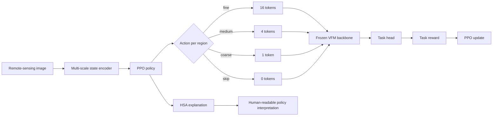

<div align="center">

# GeoRL

### Reinforcement-learning-guided adaptive tokenization for remote-sensing vision foundation models

[](https://www.python.org/)
[](https://pytorch.org/)
[](https://hydra.cc/)
[](LICENSE)

GeoRL turns token allocation into a sequential decision problem. A lightweight PPO policy inspects each region of a remote-sensing image and chooses the token budget that best matches its information density.

</div>

## Why GeoRL

Uniform patching spends the same compute on a dense urban block and a visually homogeneous water surface. GeoRL gives each region an adaptive budget while keeping the decision process inspectable.

| Capability | What GeoRL provides |
|---|---|
| Adaptive tokenization | Fine, medium, coarse, or skip actions for every base region |
| Reinforcement learning | PPO policy optimization with task, cost, and consistency rewards |
| Interpretability | Hierarchical Semantic Anchoring maps actions to semantic categories |
| Remote-sensing focus | Configurations for detection, segmentation, classification, and cross-modal transfer |
| Engineering | Hydra configs, typed PyTorch modules, checkpointing, tests, CI, and Docker support |

## Core idea



The default 512 × 512 setup divides the image into 1,024 candidate regions. The policy selects one of four actions for each region. The resulting token stream is passed to a frozen vision foundation model adapter and a task-specific head.

## Repository status

This repository is the code release accompanying the GeoRL manuscript. It includes the model, PPO objective, HSA module, configuration system, dataset adapters, evaluation utilities, tests, and CI workflow.

The default command path uses deterministic synthetic batches so the project can be installed and validated without downloading large or license-restricted datasets. Dataset modules and experiment configurations are included for extending the training loop to real data. Paper-scale benchmark numbers require the corresponding datasets and a connected dataset loader.

Pretrained checkpoints are not included. The manuscript reports results on DOTA, iSAID, LoveDA, and xView, plus cross-modal transfer settings for SAR, multispectral, and hyperspectral imagery.

## Quickstart

### Install with a virtual environment

```bash
python -m venv .venv
source .venv/bin/activate                # Windows PowerShell: .venv\Scripts\Activate.ps1
python -m pip install --upgrade pip
python -m pip install --extra-index-url https://download.pytorch.org/whl/cu121 \
  torch==2.3.1 torchvision==0.18.1
python -m pip install -r requirements.txt
python -m pip install -e .
```

### Run the smoke configuration

```bash
georl-train experiment=_smoke
```

This writes a compact training summary and checkpoint under `outputs/smoke/`.

### Inspect a checkpoint

```bash
georl-eval experiment=_smoke
georl-infer experiment=_smoke
```

The evaluation and inference commands read `outputs/<experiment>/last.pt` when it exists and write JSON summaries beside it.

## Training and evaluation commands

The main experiment configurations mirror the manuscript setup.

```bash
# Detection
georl-train experiment=main_dota
georl-train experiment=main_xview

# Semantic segmentation
georl-train experiment=main_isaid
georl-train experiment=main_loveda data.extra.scene=urban

# Scene classification
georl-train experiment=main_scene_aid
georl-train experiment=main_scene_nwpu
georl-train experiment=main_scene_patternnet

# Cross-modal transfer configurations
georl-eval experiment=transfer_sar
georl-eval experiment=transfer_ms
georl-eval experiment=transfer_hs
```

Override any Hydra field from the command line. For example:

```bash
georl-train experiment=_smoke train.seed=7 train.epochs=2
```

For multi-GPU launches, set `NPROC` and use the provided launcher.

```bash
NPROC=4 scripts/launch_train.sh main_dota
```

## Data preparation

The repository defines adapters and manifest utilities for the following datasets.

| Dataset | Task coverage | Access |
|---|---|---|
| DOTA v1.0 | Oriented object detection | [Project page](https://captain-whu.github.io/DOTA/) |
| iSAID v1.0 | Instance and semantic segmentation | [Project page](https://captain-whu.github.io/iSAID/) |
| LoveDA v1.0 | Semantic segmentation | [Repository](https://github.com/Junjue-Wang/LoveDA) |
| xView v1 | Object detection | [Project page](https://xviewdataset.org/) |

Place each downloaded dataset below `data/<name>/`. Then prepare tiles and record a SHA-256 manifest.

```bash
scripts/prepare_data.sh
scripts/compute_manifest.sh data/dota
```

`prepare_data.sh` prints the source links and expected layout. It does not download data automatically.

Dataset terms and licenses remain with their original owners. Review each dataset's license before downloading or redistributing data.

## Configuration map

```text
configs/
├── model/       State encoder, policy, value network, and VFM adapters
├── data/        Dataset and modality definitions
├── train/       PPO, optimizer, AMP, and distributed settings
└── experiment/  Main runs, ablations, transfer runs, and smoke tests
```

Important defaults for the main experiments include AdamW with a learning rate of `3e-4`, cosine decay, 50 epochs, FP16, four PPO epochs per update, and reward weights `alpha=1.0`, `beta=0.3`, `lambda=0.1`.

## Code map

```text
src/georl/
├── models/       State encoder, adaptive tokenizer, VFM adapters, task heads
├── rl/           MDP, actions, rewards, GAE, policy, and rollout buffer
├── losses/       Task, consistency, and PPO objectives
├── hsa/          Hierarchical Semantic Anchoring and explanations
├── data/         Dataset adapters, transforms, and manifests
├── training/     Training loop, AMP, DDP, checkpointing, and EMA
├── evaluation/   Inference and task-level evaluation helpers
└── cli/          georl-train, georl-eval, georl-infer, georl-export
```

## Tests and quality checks

Run the fast local checks with:

```bash
pytest -q -m "not slow"
ruff check .
black --check .
isort --check-only --profile black .
mypy --strict src/georl
```

GitHub Actions runs linting, type checking, and the test suite on pushes and pull requests to `main`.

## Docker

Build the CUDA image and run the smoke configuration.

```bash
docker build -t georl:latest .
docker run --gpus all -v ${PWD}/data:/workspace/data georl:latest experiment=_smoke
```

## Reproducibility notes

- The smoke configuration is deterministic and CPU-friendly.
- Real benchmark runs depend on dataset versions, preprocessing, GPU memory, and the selected VFM adapter.
- Generated artifacts such as checkpoints, experiment outputs, datasets, and tracking logs are ignored by Git.
- The reported manuscript compute setup is four GPUs, FP16, and an effective batch size of 32.

## Citation

```bibtex
@article{he2026georl,
  title   = {GeoRL: Adaptive Tokenization via Reinforcement Learning for Remote Sensing Foundation Models},
  author  = {He, Hengyang and Zhang, Le and Zhu, Ce},
  journal = {Pattern Recognition},
  year    = {2026}
}
```

## License

The source code is released under the Apache License 2.0. Dataset licenses and access conditions are governed by the individual dataset providers.

